# 📊 DIAGRAMMES DE FLUX - PLATEFORME RÉSERVATION HÔTELS

## 1. Flux Global du Système

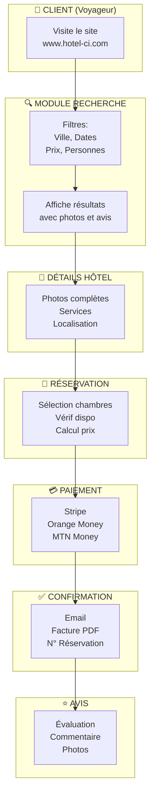

## 2. Système de Rôles et Permissions

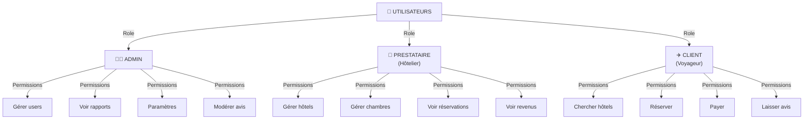

## 3. Architecture MVC

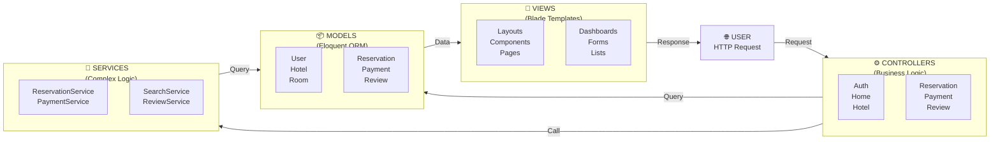

## 4. Flux de Paiement

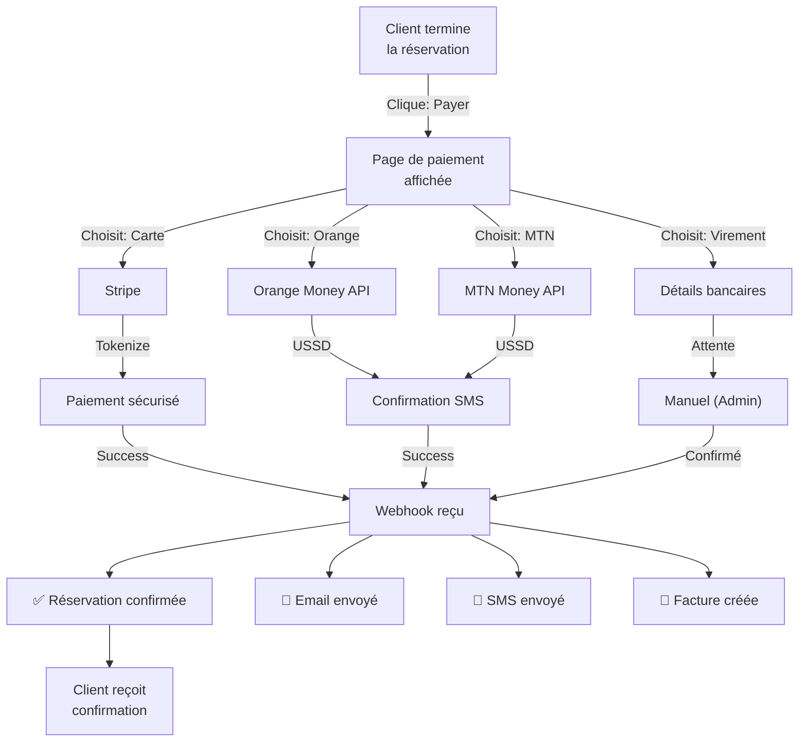

## 5. Disponibilité des Chambres

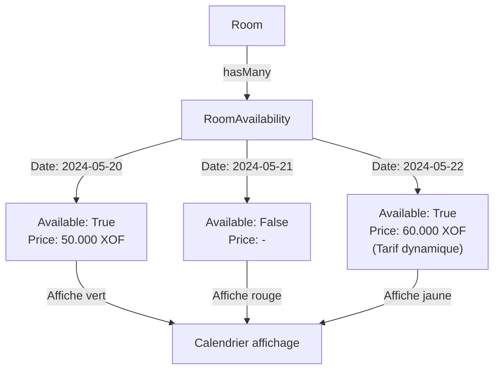

## 6. Workflow Complet Réservation

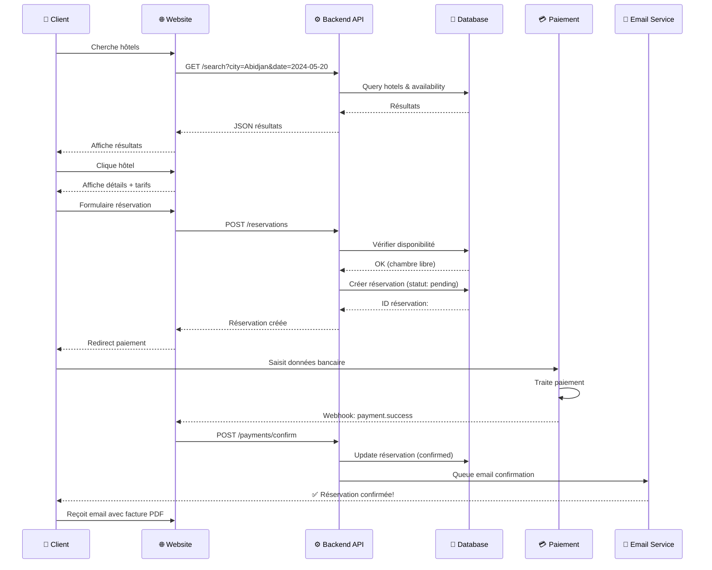

## 7. Structure Base de Données

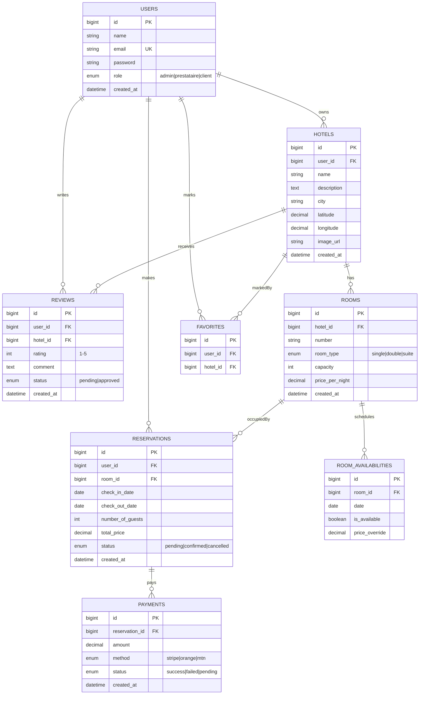

## 8. Sécurité - Flux d'Authentification

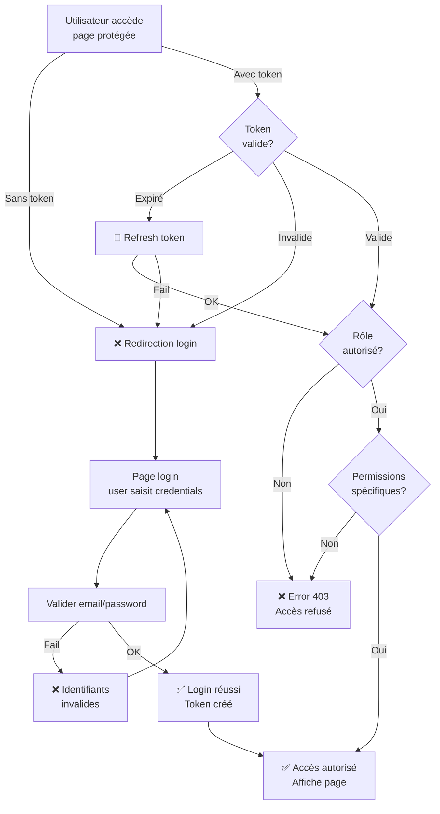

## 9. Process Avis et Modération

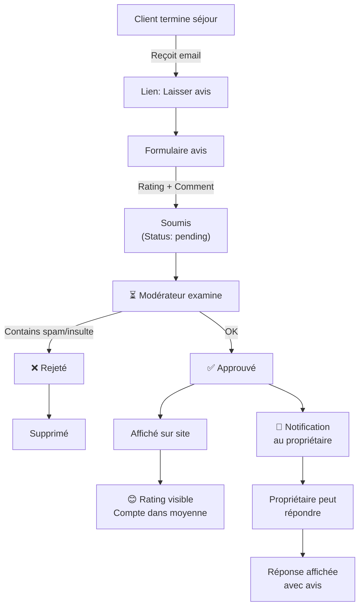

## 10. Calendrier Disponibilité

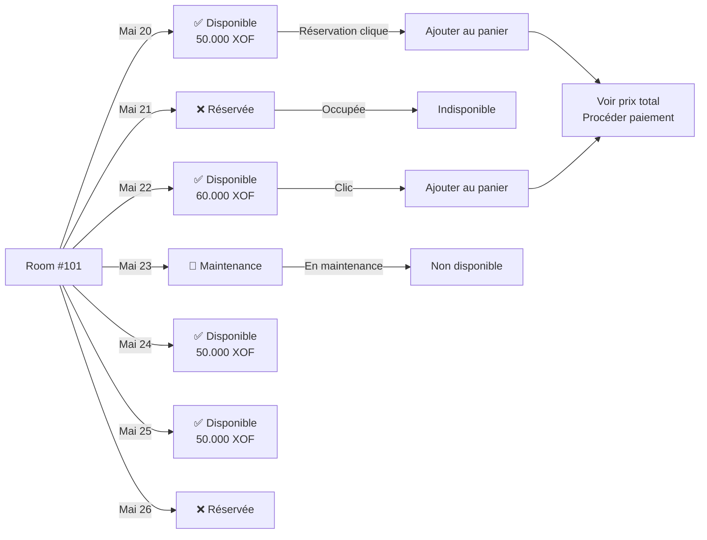

## 11. Notifications Multi-Canal

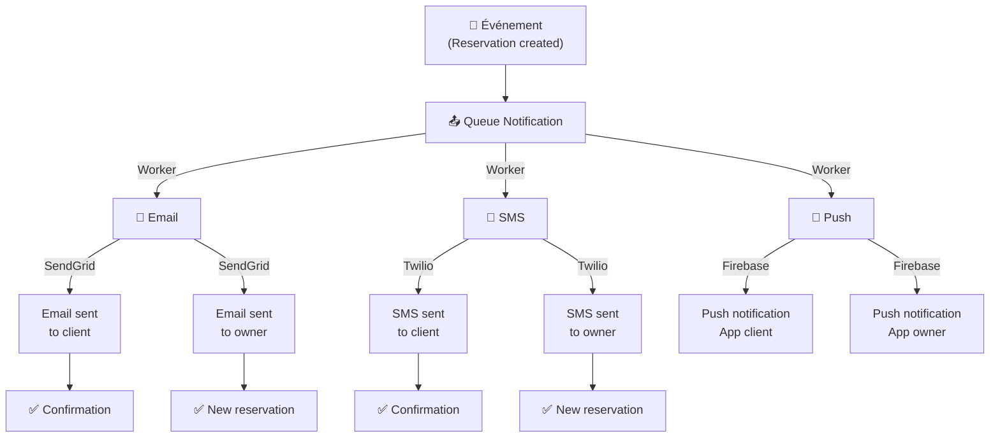

## 12. Dashboard Prestataire (Propriétaire)

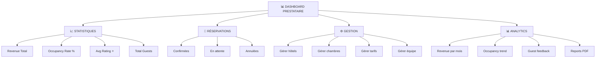

---

**Ces diagrammes vous aident à visualiser l'architecture complète! 📊**
